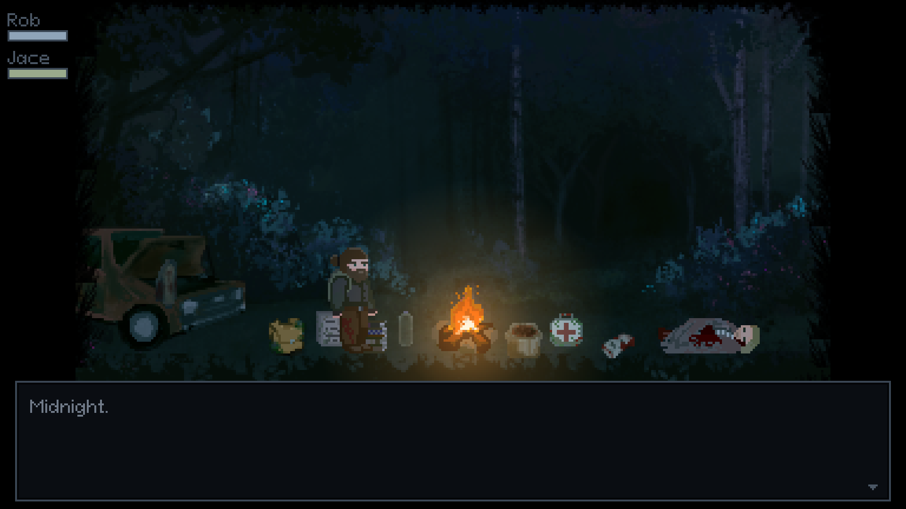
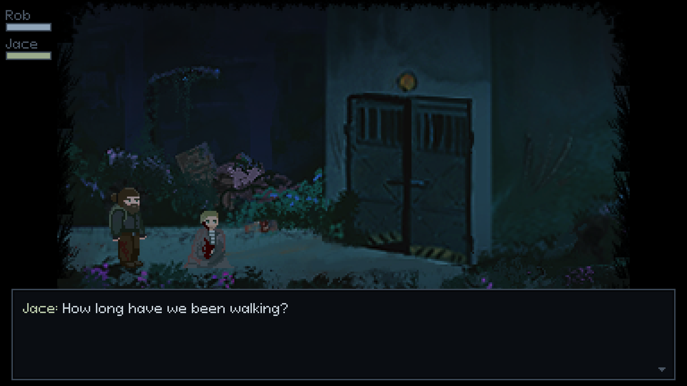
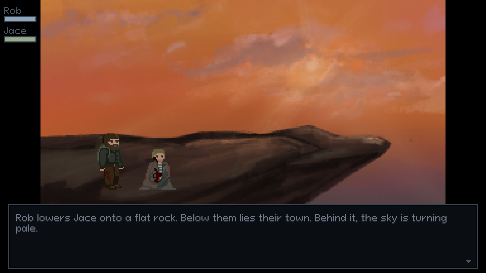

# While It Lasts

*Midnight. A dying friend. One mountain left to climb before sunrise.*

**While It Lasts** is a short narrative game about friendship and what you do
with the time that's left. Rob half-carries his friend Jace up the mountain
where they grew up, through an abandoned factory, a guarded perimeter and the
long stairs to the summit, with something following them the whole way.



## Play

**Windows:** download the zip from the [latest release](../../releases/latest),
unpack it and run `While It Lasts.exe`. Keep the program next to its `assets`
folder. Nothing else needs to be installed.

**Linux:** [build it from source](#build-from-source).

The game is played with the keyboard only:

| Key | What it does |
|---|---|
| A / D, ← / → | Walk |
| E | Use the thing marked with the E prompt, or talk to Jace |
| W / S, ↑ / ↓ | Pick another thing when several are within reach |
| G | Take hold of Jace when he can't walk, and let go of him |
| F, R, Q | In a fight: swing the bat, shoot, dodge back |
| E, Space, Enter | Next line (the first press shows the whole line) |
| ↑ / ↓ or 1–4, then E or Enter | Choose an option |
| Tab, I | Inventory (arrows to look through it, E to use a bandage, the antibiotics, a bottle, …) |
| Esc | Pause |
| F11, Alt+Enter | Fullscreen / window |

## The game

The night runs from midnight at the campsite to sunrise on the summit, across
five stages: the campfire, the factory, the perimeter, the mountain steps and
the summit.

- **Choices that come back.** What you take, share, read or leave behind shows
  up later in a line or a scene, and the ending changes with it.
- **Keeping Jace alive.** Rob's health and Jace's condition are both on screen.
  Bandages, antiseptic and antibiotics are limited, and when Jace can't walk,
  Rob has to drag him.
- **Tense encounters.** Timed decisions, real-time fights, waves of crawlers and
  a stealth section at the checkpoint. A thrown bottle can buy you a way past.
- **The Reaper.** It appears in every stage, a little closer each time.

| | |
|---|---|
|  |  |

## Build from source

You need a C++20 compiler (MSVC, GCC or Clang), CMake 3.21 or newer, Ninja and
git. On Windows, use a *Developer PowerShell for VS*. raylib, nlohmann/json and
GoogleTest are downloaded into `extern/` the first time you configure.

```bash
cmake -S . -B build/Release -G Ninja -DCMAKE_BUILD_TYPE=Release
cmake --build build/Release
ctest --test-dir build/Release
```

The game is then in `build/Release/bin`, with its `assets` folder next to it.
[docs/BUILDING.md](docs/BUILDING.md) covers the VS Code tasks, build options and
dependencies.

The program also takes a few options:

```
"While It Lasts"                                            fullscreen
"While It Lasts" --windowed                                 a 1280 x 720 window
"While It Lasts" --check                                    read and check every data file, no window
"While It Lasts" --room summit --set cig_count=0            start anywhere, with any state
"While It Lasts" --walkthrough tests/walkthrough/full.txt   play the game by itself
```

## How it's made

The game is written in C++20 with [raylib](https://www.raylib.com), and the
story is data rather than code: dialogue, rooms, items and story variables are
JSON files in `assets/data/`.

| Folder | What's in it |
|---|---|
| `apps/app/` | The game: screens, rooms, interaction, fights, the near-death scene, the Reaper and each room's script |
| `include/while_it_lasts/`, `src/` | The systems it's built from: canvas, input, audio, story state, dialogue, data loading, actors, effects and UI |
| `assets/` | The story data, art, sounds and fonts |
| `tests/` | Unit tests, story branches on the real data, and full playthroughs |
| `docs/` | The guides below |

- [docs/ARCHITECTURE.html](docs/ARCHITECTURE.html): how the code works
- [docs/DATA-FORMAT.md](docs/DATA-FORMAT.md): how to write rooms, dialogue and items
- [docs/DECISIONS.md](docs/DECISIONS.md): the design decisions and how choices play out (contains spoilers)

## Credits

**N2 Team**

- Art: Faeze, Danial
- Code: Isef

**Music** by Kevin MacLeod ([incompetech.com](https://incompetech.com)), licensed
under [Creative Commons: By Attribution 4.0](https://creativecommons.org/licenses/by/4.0/):
"Stages of Grief", "Distant Tension", "Ossuary 6 - Air", "Ossuary 5 - Rest" and
"Heartbreaking".

**Sound effects** are made from recordings by Work With Sounds / Technical Museum
of Slovenia, Thatcher, TwoWings, Gravity Sound, Glaneur de son, Kenney and others.
[assets/sounds/CREDITS.md](assets/sounds/CREDITS.md) lists every source and licence.

**Fonts:** Pixeloid Sans and Greybeard, with their licences in
[assets/fonts/](assets/fonts/).

**Built with** [raylib](https://www.raylib.com),
[nlohmann/json](https://github.com/nlohmann/json) and
[GoogleTest](https://github.com/google/googletest).

## License

Copyright (c) 2026 the While It Lasts authors. All rights reserved. See
[LICENSE.md](LICENSE.md).
